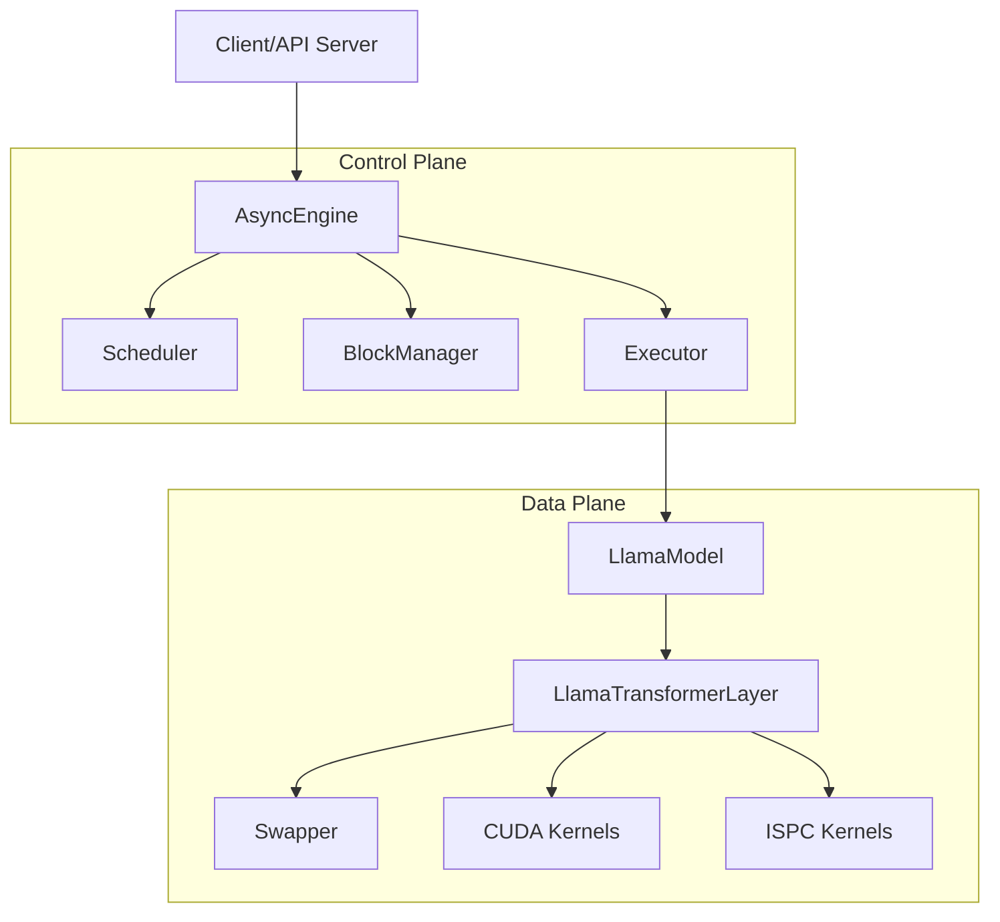

# NEO 系统架构分析文档

NEO 是一个专为在线 LLM 推理设计的系统，其核心思想是通过**非对称 GPU-CPU 流水线（Asymmetric GPU-CPU Pipelining）**和**负载感知调度（Load-aware Scheduling）**，利用 CPU 的内存和算力来克服 GPU 显存对 Batch Size 的限制。

---

## 1. 总体架构概述

项目结构主要分为控制平面（Control Plane）和数据平面（Data Plane）：

*   **控制平面 (`swiftllm/server/`)**：负责请求调度、块管理（Block Manager）和执行任务派发。
*   **数据平面 (`swiftllm/worker/`)**：负责具体的模型计算、权重管理和 GPU-CPU 之间的数据交换（Swapping）。
*   **加速内核**：
    *   `pacpu/`：使用 Intel ISPC 编写的 CPU 端加速算子。
    *   `csrc/`：自定义的 GPU CUDA 算子（如块交换、融合内核）。

### 模块依赖关系 (Mermaid)

---

## 2. 核心模块分析

### 2.1 控制平面 (Control Plane)

*   **`Engine` & `AsyncEngine` (`swiftllm/server/engine.py`)**
    *   系统的总入口。`AsyncEngine` 运行两个主要的异步循环：
        1.  `_tokenize_raw_request_event_loop`：处理请求的 Tokenization。
        2.  `_main_event_loop`：驱动模型前进。它从调度器获取下一批次任务，准备映射关系，并调用执行器执行。
*   **`Scheduler` (`swiftllm/server/scheduler.py`)**
    *   实现了基于 FCFS（先来先服务）的调度策略。
    *   **核心逻辑**：根据 `PerfPredictor`（性能预测器）决定当前应当采用**串行模式**还是**流水线模式**。
    *   管理三种队列：`waiting_q`（等待队列）、`gpu_decoding_q`（GPU 解码队列）和 `cpu_decoding_q`（CPU 解码队列）。
*   **`BlockManager` (`swiftllm/server/block_manager.py`)**
    *   负责管理逻辑块（Virtual Blocks）到 GPU/CPU 物理块的映射。
    *   支持 PagedAttention 机制，并处理 Swap In/Out 的索引分配。

### 2.2 数据平面 (Data Plane)

*   **`LlamaModel` (`swiftllm/worker/model.py`)**
    *   管理模型权重、KV Cache 缓存空间以及 RoPE 缓存。
    *   支持单卡及多卡（通过 Ray 和 NCCL）运行。
    *   实现了 `_forward_pipeline` 方法来支持 GPU 和 CPU 的并行计算。
*   **`LlamaTransformerLayer` (`swiftllm/worker/layers/transformer_layer.py`)**
    *   这是计算最核心的地方。每个 Transformer 层被拆解为：
        *   `_preproj`：RMSNorm + QKV 计算。
        *   `_attention`：GPU 端 PagedAttention 或 CPU 端 `pacpu.paged_attention_cpu`。
        *   `_postproj`：Attention 后处理及 FFN。
    *   在流水线模式下，它通过非阻塞的 `copy_` 操作将 QKV 数据转移到 CPU。
*   **`Swapper` (`swiftllm/worker/block_swapper.py`)**
    *   封装了 CPU 和 GPU 之间进行块交换的底层细节，利用 `swiftllm_c` 提供的 CUDA 扩展实现高效的数据迁移。

---

## 3. 关键特性实现方案

### 3.1 非对称 GPU-CPU 流水线 (Asymmetric Pipelining)

NEO 通过在层（Layer）级别实现计算重叠。
在流水线模式下，模型会同时处理两个 Sub-batch：
1.  **Batch 0** 在 GPU 上执行其后处理（Post-projection）和下一层的预处理，并执行其 Attention 计算。
2.  **Batch 1** 此时在 CPU 上执行其特定的 Attention 计算。

这种设计使得 GPU 的计算资源和内存带宽与 CPU 端的计算任务得以重叠。

### 3.2 内存管理与卸载 (Offloading)

*   **PagedAttention**：NEO 深度集成了 PagedAttention，通过 `block_size`（默认 16）将 KV Cache 切片管理。
*   **双重块管理**：系统同时维护 `gpu_block_table` 和 `cpu_block_table`。当 GPU 压力过大时，`Scheduler` 会触发 Swap Out，将受害者的块移动到 CPU。

### 3.3 CPU 计算加速 (`pacpu/`)

为了解决 CPU 计算效率低的问题，NEO 引入了 `pacpu` 模块：
*   **ISPC 优化**：利用 Intel ISPC 控制 SIMD 指令，大幅提升了在 x86-64 架构上执行 QK 乘积和 Softmax 的效率。
*   **非阻塞通信**：使用了专门的 `cpu_communication_stream`（CUDA Stream）进行数据拷贝，避免阻塞 GPU 的主计算流。

---

## 4. 关键数据结构 (`swiftllm/structs.py`)

*   **`Request`**：封装了一个完整的推理请求信息，包括 Token 序列、ID 以及输出队列。
*   **`SubBatch`**：推理的基本单位。它包含了一组请求的索引、长度、位置信息，以及用于调度决策的性能度量（`BatchPerfData`）。

---

## 5. 总结

NEO 的架构设计展现了高度的工程优化：
1.  **解耦控制与计算**：通过 AsyncEngine 和 Scheduler 解耦了复杂的调度算法与底层的算子执行。
2.  **异构计算协同**：不单纯将 CPU 视为备份内存，而是通过 ISPC 内核让其参与 Attention 计算，实现了真正的异构流水线。
3.  **高性能扩展**：通过 C++/CUDA 扩展和 ISPC 的结合，确保了在关键链路上的极致性能。
